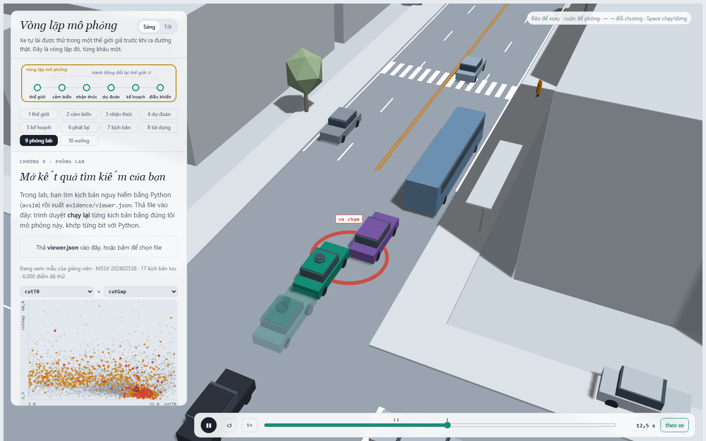
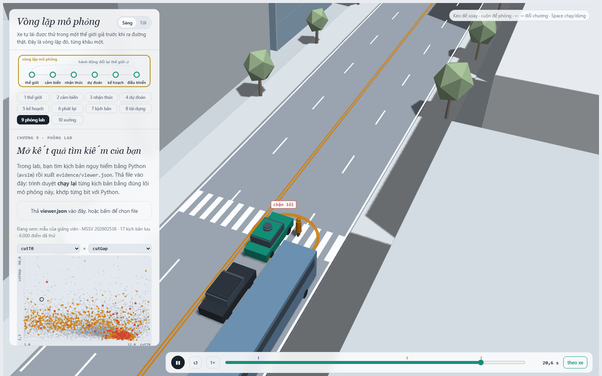
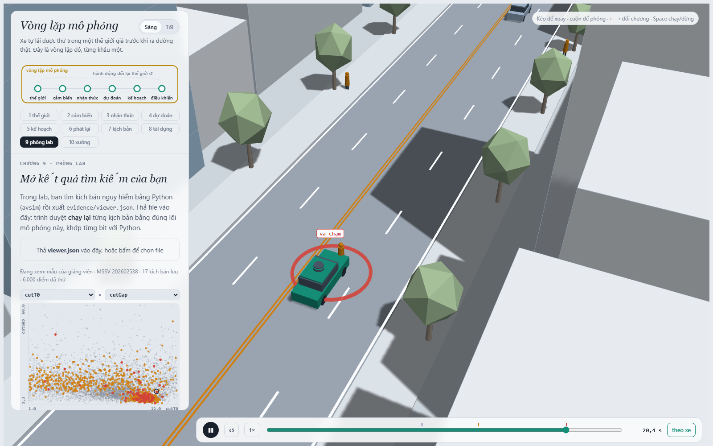

MSSV: 202602538

# Lab 11 · Scenario Forge — báo cáo

Thị trấn: **D** (`meta.json: _run.town = "D"`). Toàn bộ số dưới đây lấy từ lần chạy chuẩn, `quick = false`.

## 1. Phát lại log có trung thực không?

Trong 400 kịch bản, một log bị loại vì chính người lái gây va chạm, còn 399 log được dùng (`replay.json: dropped_human_crash_logs = 1`, `n_used = 399`). Planner trên log phát lại gây 114 va chạm: 104 từ phía sau và 10 bên hông; thế giới phản ứng không có va chạm nào (`replay.json: replay.crashes = 114`, `replay.contact = {rear: 104, side: 10}`, `reactive.crashes = 0`, `crash_in_both = 0`).

Phần lớn va chạm phát lại là `rear` vì planner phanh sớm hơn người lái đã ghi log, nhưng xe bám đuôi trong log cứ chạy theo quỹ đạo cũ và không biết phải phản ứng với hành động mới của planner. Đây là va chạm giả do phá vỡ quan hệ nhân quả. Ví dụ `replay.json: replay_only[0]`, scenario 5: log phát lại bị tông đuôi, trong khi ở thế giới phản ứng xe sau giảm tốc theo ego và TTC nhỏ nhất vẫn là 2,495 s nên không va chạm.

## 2. Kịch bản bất khả thi

`lab11/feasible.py:is_feasible` loại kịch bản nếu: (1) gia tốc ngang cực đại của chuyển làn, `(π/cutDur)^2·3.5/2`, vượt `μg`, vì lốp không thể tạo lực ngang đó; (2) `cutBrake > μg`, vì phanh vượt giới hạn ma sát; (3) `pedV > 2.5 m/s`, vì đối tượng khi ấy đã chạy thay vì đi bộ; hoặc (4) `cutV` không thuộc `(0, 22] m/s`, vì xe đứng/đi lùi hoặc vượt miền tốc độ đô thị của mô hình.

Cuộc săn `rear_ended` sinh nhiều mẫu bất khả thi nhất: 17, so với 9 cho `crosswalk_block`, 6 cho `bus_bypass`, và 1 cho `cut_in` (`hunt.json: <mode>.infeasible`). CEM bị kéo về các biên vật lý vì chuyển làn cực nhanh, phanh cực mạnh hoặc độ bám thấp thường có điểm nguy hiểm cao nhất. Nếu vẫn chạy và đếm chúng là va chạm, ước lượng sẽ gán xác suất cho những chuyển động không thể xảy ra, làm xác suất thất bại bị thổi phồng và proposal học sai vùng.

## 3. Monte Carlo cho biết gì?

Monte Carlo không thấy va chạm nào trong 3.000 lần: `k = 0`, `p̂ = 0`, Wilson 95% xấp xỉ `[0, 1.2789×10⁻³]` (`mc.json: crashes = 0`, `n = 3000`, `lo ≈ 0`, `hi = 0.0012788957`). Giá trị 0 chỉ là ước lượng điểm, không có nghĩa planner tuyệt đối an toàn.

Công thức ngân sách cho sai số tương đối ±20% là xấp xỉ `n ≈ 96/p`. Vì MC cho `p̂ = 0`, không thể suy ra một ngân sách hữu hạn từ chính điểm ước lượng này. Nếu dùng trung vị IS `p ≈ 2.6983×10⁻⁴`, cần khoảng `96/p ≈ 355.800` rollout; ngay cả nếu dùng cận trên Wilson của MC thì vẫn cần khoảng 75.100. Cả bốn mode và `other` đều chưa xuất hiện (`mc.json: per_mode.*.k = 0`); phải báo cận trên Wilson 0,0012789 cho mỗi mode, không báo xác suất bằng 0.

## 4. Importance sampling, ESS và độ suy biến

| Seed | Mode | p | Hits | ESS | top_share |
|---:|---|---:|---:|---:|---:|
| 0 | bus_bypass | 2.69499e-4 | 39 | 123.67 | 0.179 |
| 0 | cut_in | 0 (cận 0-hit 0.025) | 0 | 106.39 | 0 |
| 0 | crosswalk_block | 3.29845e-7 | 84 | 124.17 | 0.252 |
| 0 | rear_ended | 0 (cận 0-hit 0.025) | 0 | 118.10 | 0 |
| 1 | bus_bypass | 2.05318e-4 | 36 | 122.64 | 0.382 |
| 1 | cut_in | 0 (cận 0-hit 0.025) | 0 | 157.24 | 0 |
| 1 | crosswalk_block | 1.38612e-6 | 67 | 129.40 | **0.537** |
| 1 | rear_ended | 0 (cận 0-hit 0.025) | 0 | 123.01 | 0 |
| 2 | bus_bypass | 7.79865e-4 | 37 | 130.65 | 0.219 |
| 2 | cut_in | 0 (cận 0-hit 0.025) | 0 | 117.13 | 0 |
| 2 | crosswalk_block | 4.88606e-7 | 70 | 137.13 | 0.151 |
| 2 | rear_ended | 0 (cận 0-hit 0.025) | 0 | 108.04 | 0 |

Các giá trị lấy từ `estimate.json: seeds[*].per`. Tổng theo ba seed lần lượt là 2.69829e-4, 2.06704e-4 và 7.80354e-4. Ba seed chỉ đồng ý về bậc độ lớn, không ổn định về trị số: `bus_bypass` lệch 3,8 lần, còn `crosswalk_block` lệch 4,2 lần. Điều này vẫn tương thích với MC 0/3000 vì các xác suất rất nhỏ và khoảng MC rộng.

`top_share > 0.5` xảy ra ở `crosswalk_block`, seed 1: 0,5369. Nghĩa là hơn nửa ước lượng đến từ đúng một mẫu có trọng số lớn; CI chuẩn khi ấy dễ quá lạc quan. ESS chỉ khoảng 106–157 dù mỗi phép ước lượng dùng 600 mẫu, cho thấy trọng số lệch đáng kể.

Ngân sách IS là 16.800 rollout (`estimate.json: budget = 16800`), khoảng 21 lần ít hơn ~355.800 rollout MC cần cho ±20% quanh trung vị IS, nhưng đổi lại có biến thiên seed và nguy cơ proposal bỏ sót mode. `other` lấy nguyên từ Monte Carlo (`estimate.json: other.source = "mc.json"`, `k = 0`, `hi = 0.0012789`) vì đây là phần dư không có một score/mode rõ để CEM săn có mục tiêu.

## 5. Các kiểu thất bại

Cuộc săn `bus_bypass` tìm 105 va chạm đúng mode. C2 tìm khe chuyển làn, bị xe buýt dừng che hành lang, lách chậm qua đầu xe buýt; ego chỉ coi C2 là leader khi chồng làn đủ nhiều nên phản ứng muộn và đâm vào C2.

Cuộc săn `crosswalk_block` tìm 40 lỗi đúng mode (và 2 `bus_bypass`). Người đi bộ P1 chờ khe, xuất hiện từ sau xe buýt; ego phanh nhưng dừng khi thân xe đã nằm trên vạch, buộc P1 dừng lại (`kind = block`).

Cuộc săn `cut_in` không tìm được `cut_in` mà tìm 18 `bus_bypass`; cuộc săn `rear_ended` cũng không tìm đúng mode mà tìm 1 `bus_bypass` (`hunt.json: <mode>.found`). Vì vậy bằng chứng cho hai mode này chỉ là không thấy trong ngân sách hiện tại, không phải chứng minh chúng không tồn tại; cận 0-hit IS là 0,025 mỗi seed. Nếu chỉ chạy một cuộc săn chung, CEM sẽ co về vùng `bus_bypass` dễ đạt score/crash nhất và gần như che mất `crosswalk_block`; kết quả các cuộc săn riêng đã minh họa đúng hiện tượng này.

## 6. Sửa planner

Policy được chọn trên TRAIN là `{"cutinLat": 3.0}` (`fix.json: chosen.policy`). Trên TRAIN, nó có `fail = 6.16166e-7`, `fail_hi = 1.19837e-6`, progress 217,897 m và 7,297 frame phanh gấp trung bình. Policy gốc trên TRAIN có `fail = 3.25184e-4`, `fail_hi = 6.69031e-4`, progress 217,676 m và 8,184 frame phanh gấp (`fix.json: chosen`, `baseline_train`).

Trên TEST độc lập, policy chọn có `fail = 6.11474e-7`, `fail_hi_seen = 1.64158e-6`, nhưng cận hợp lệ toàn policy `fail_hi = 0.0387805` vì `bus_bypass` không xuất hiện và phải cộng cận 0-hit 0,0375 cùng cận `other`. Policy gốc có `fail = 2.65460e-4`, `fail_hi_seen = 5.01925e-4`, `fail_hi = 0.00178082` (`fix.json: chosen_test`, `baseline_test`). Do đó điểm ước lượng của bản sửa tốt hơn rất nhiều nhưng ngân sách chưa đủ để chứng nhận nó tốt hơn theo cận trên hợp lệ.

Progress TEST gần như không đổi: 218,195 m so với 218,250 m (giảm 0,025%); phanh gấp giảm từ 7,766 xuống 7,432 frame (`fix.json: chosen_test.progress/harsh`, `baseline_test.progress/harsh`). Trong ảnh bus bypass phía trên, xe trong suốt là policy còn lại trên cùng kịch bản; tăng `cutinLat` khiến ego nhận C2 là leader sớm hơn.

Một núm “nghe an toàn” nhưng phản tác dụng là tăng headway `T` lên 2,0: trên TRAIN `fail = 3.644998e-4`, cao hơn baseline 3.251840e-4, dù progress giảm còn 208,592 m (`fix.json: table`, hàng `{"T": 2.0}`). Trong thế giới phản ứng, ego phanh/nhường sớm làm thay đổi khe mà C2 chấp nhận và phản ứng của xe bám đuôi; vì thế chỉ tăng khoảng cách mong muốn không đảm bảo giảm mọi mode thất bại.

## 7. Từ mô phỏng ra đường thật

1. **Khe chấp nhận của xe chuyển làn (`cutGap`).** Thay giả định log-normal bằng phân bố học từ quỹ đạo naturalistic/fleet có track xe lân cận, đo khoảng trống ngay lúc bắt đầu nhập làn và phân tầng theo tốc độ, thời tiết. Nếu mô hình hiện tại cho khe quá lớn, nó đánh giá thiếu các pha nhập làn gấp và xác suất va chạm sẽ thấp giả.
2. **Tỷ lệ người đi bộ nhìn qua xe buýt (`pedLook`).** Ước lượng từ video giao lộ/camera ven đường có nhãn hướng đầu, thời điểm bước xuống và che khuất. Nếu tỷ lệ thực thấp hơn 0,90 của town D, mô phỏng đang có quá nhiều người thận trọng nên đánh giá thiếu `crosswalk_block`.
3. **Tỷ lệ đường ướt và hệ số ma sát (`wet`, `μ`).** Kết hợp lịch sử thời tiết, dữ liệu ABS/ESC hoặc đo ma sát mặt đường theo tuyến; dùng phân bố μ liên tục thay vì hai điểm 0,5/0,8. Nếu μ thực thường thấp hơn, quãng phanh dài hơn và cả lỗi bus/pedestrian sẽ bị đánh giá thấp trong mô phỏng.

## 8. Giới hạn

- Xác suất chỉ áp dụng cho một bản đồ/phố và tập tác nhân cố định; không nói gì về cao tốc, nút giao khác, xe máy, công trường hay nhiều người đi bộ đồng thời.
- Người lái khác chỉ tuân IDM/gap acceptance xác định; kết quả không bao phủ mất tập trung, hung hăng, tín hiệu giao tiếp hay sai lệch hành vi có tương quan.
- Cảm biến hoàn hảo ngoài che khuất hình học bởi xe buýt; không có nhiễu camera/LiDAR, bỏ sót, độ trễ perception, mưa chói hoặc lỗi định vị.

Nếu có thêm một tuần, tôi sẽ làm kiểm thử đa độ trung thực: thêm nhiễu/độ trễ perception và nhiều bản đồ, hiệu chỉnh ba phân bố ở câu 7 bằng dữ liệu thật, rồi chạy sequential importance sampling đến khi CI ổn định giữa seed thay vì chỉ tăng mù quáng số lượt Monte Carlo.

## 9. Rắc rối tự thiết kế

**Rắc rối.** Một người đi bộ băng ngang ngoài vạch từ lề phải, tương tự người bất ngờ qua đường giữa hai nút giao. Planner hiện ưu tiên logic thận trọng gần vạch bị che; ngoài vạch, người đi bộ mới kích hoạt có thể bước vào hành lang trước khi planner giảm đủ tốc độ.

**Giả định.** `hazard.json: space = {h0_x:[100,285], h0_v:[1.0,2.5], h0_trig:[5,60]}`; các dải lần lượt bao phủ phần đường trước giao lộ, từ đi bộ thường đến bước nhanh chưa vượt ngưỡng “chạy”, và từ xuất hiện rất muộn đến có khoảng quan sát dài. `exposure = 0.01/chuyến` là giả định một lần gặp loại tương tác này trong 100 chuyến đô thị; `hazard.json: why` nêu rõ cần hiệu chỉnh bằng video giao thông/naturalistic driving địa phương.

Trong cảnh chính, planner va H0 tại 23,0 s (`mine.json: exact.planner`). Quét chuẩn chấp nhận 1489/1500 = 99,27% mẫu (`mine.json: accepted = 0.992667`). Kết quả:

| Policy | Va chạm | Avoidable | Unavoidable | Unattributed | Low speed | P(lỗi \| hazard), Wilson 95% | Mỗi chuyến |
|---|---:|---:|---:|---:|---:|---:|---:|
| Gốc | 33 | 32 | 0 | 1 | 1 | 0.02149 [0.01526, 0.03018] | 2.1491e-4 |
| `cutinLat=3.0` | 31 | 31 | 0 | 0 | 0 | 0.02082 [0.01471, 0.02940] | 2.0819e-4 |

Các số lấy từ `mine.json: baseline` và `chosen`. So với tần suất `bus_bypass` IS khoảng 2.05e-4–7.80e-4 mỗi chuyến/kịch bản tự nhiên (`estimate.json`), hazard mới sau khi nhân exposure có cùng bậc nhưng ở phía thấp của dải. Bản sửa chỉ giảm 1 lỗi có quy thuộc và không giải quyết bản chất jaywalking.

`avoidable` nghĩa oracle biết ngay khi hazard vừa hoạt động **và đã nhìn thấy**, rồi phanh tối đa; đây là chuẩn lạc quan và có thể đếm nhiều hơn khả năng của planner thực có độ trễ/giới hạn êm dịu. Ngược lại, oracle chỉ thử phanh, không thử đánh lái nên có thể đếm ít hơn số tình huống một planner đầy đủ tránh được. Ở đây `avoidable_foreknown = avoidable = 32` cho baseline, nên che khuất không tạo chênh lệch trong các lỗi đã thấy. `unavoidable` là vẫn va dù phanh tối đa; `unattributed` là va chạm nền trước/không do H0, không được tính là lỗi của hazard.

Tôi không tự lái cảnh này nên không tuyên bố kết quả người lái. Oracle cho thấy phanh tối đa đúng lúc nhìn thấy tránh được toàn bộ 32 va chạm quy thuộc baseline. Không núm hiện có nào mô tả “thận trọng trước người có ý định băng ngang ngoài vạch”; cách sửa cụ thể là thêm prediction cho mọi pedestrian gần mép đường, ước lượng time-to-lane/uncertainty, tạo vùng caution động và giảm tốc sớm khi TTC của người đi bộ chồng với hành lang ego. `pedBuffer` có thể dùng như biên sau khi thêm logic này, nhưng tự nó không đủ nếu planner chưa nhận diện hazard ngoài vạch.
